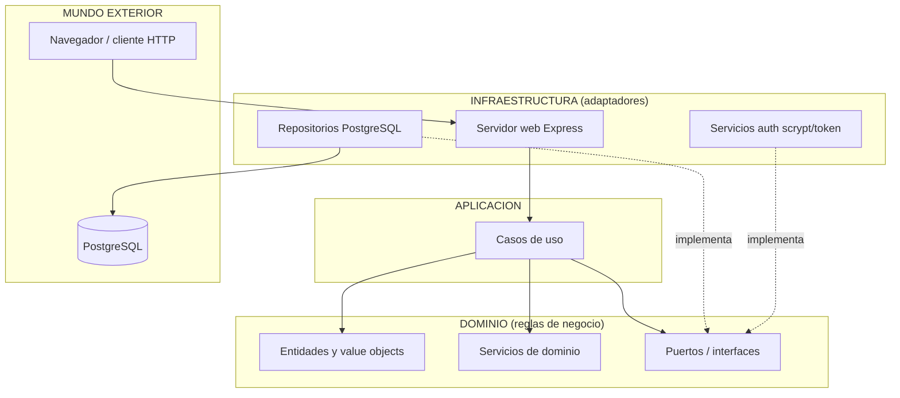
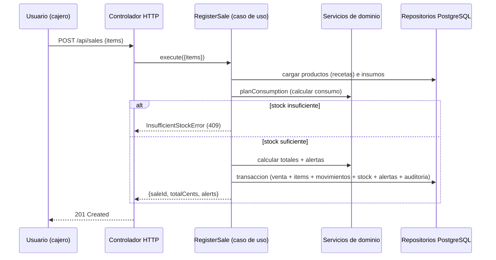

# Arquitectura de la solucion

## Clean Architecture (Robert C. Martin)

La aplicacion sigue los principios de Clean Architecture ("Uncle Bob"):

- **Entidades y value objects** (nucleo): reglas de negocio puras.
- **Casos de uso**: orquestan la logica de negocio.
- **Puertos (interfaces) y adaptadores**: separan el dominio de la infraestructura.
- **Regla de dependencia**: las dependencias apuntan **hacia adentro**; el
  dominio no depende de nada externo.



## Capas

| Capa | Responsabilidad | Depende de |
| --- | --- | --- |
| `domain` | Entidades, value objects, servicios puros, puertos | nada |
| `application` | Casos de uso (orquestacion) | `domain` |
| `infrastructure` | PostgreSQL, auth, Express, controladores | `domain`, `application` |
| `config` | Lectura de variables de entorno | nada |

## Flujo de una venta (dato -> decision -> accion -> retroalimentacion)



## Inversion de dependencias

El unico lugar que conoce las implementaciones concretas es la **raiz de
composicion** (`src/app.js`). Ahi se instancian los repositorios PostgreSQL, los
servicios y los casos de uso, y se inyectan por constructor. Esto permite probar
los casos de uso con repositorios falsos (ver `test/`).

## Contenedores (Docker)

```
[ cdq-app (node:22-alpine) ] --DATABASE_URL (red)--> [ cdq-db (postgres:16-alpine) ]
                                                       [ volumen pg-data: /var/lib/postgresql/data ]
```

La aplicacion se conecta a PostgreSQL por red (`DATABASE_URL`) y crea el esquema
y siembra los datos de prueba (idempotente). El volumen `pg-data` persiste
unicamente los datos operativos (variables); los datos fijos de prueba viven en
el codigo (`seed.js`).
