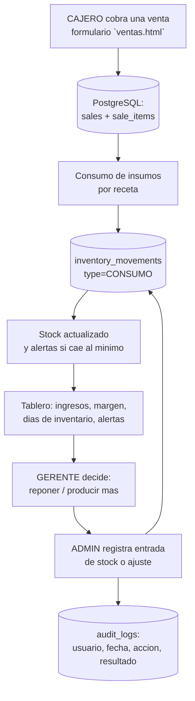

# Flujo de informacion: dato → decision → accion → retroalimentacion

Documenta el ciclo completo que el prototipo implementa, y clasifica cada pieza
como **dato**, **informacion**, **conocimiento**, **decision**, **accion** o
**retroalimentacion**, tal como lo pide la guia de la unidad.

## El ciclo en una venta

## Clasificacion de cada pieza

| Etiqueta | Elemento concreto | Detalle |
| --- | --- | --- |
| **Dato** | Venta capturada (`items`, cantidad, cliente) | Entrada cruda desde el mostrador; `POST /api/sales` |
| **Dato** | Movimiento de inventario (`type`, `quantity`, `reason`) | Entrada cruda desde la vista de Inventario |
| **Informacion** | `sales`, `sale_items`, `inventory_movements`, `sessions`, `audit_logs` | Datos almacenados, con esquema, tipos y claves foraneas |
| **Conocimiento** | Tablero (`GET /api/dashboard?days`) | Ventana 1/7/30 con variacion vs. periodo anterior, margen bruto por producto, dias de inventario restante, alertas por severidad y recomendacion SMA |
| **Decision** | Alertas `LOW_STOCK` y recomendacion de produccion | El sistema propone; el gerente decide reponer o producir |
| **Decision** | Margen y dias de inventario | Respaldan la decision de precio, compra y produccion |
| **Accion** | Entrada de stock, ajuste, resolver alerta, crear producto/usuario | Acciones explicitas del usuario sobre el sistema |
| **Retroalimentacion** | `audit_logs` + recomputo del tablero | Toda accion queda registrada y vuelve a aparecer en el conocimiento |

## Almacenamiento y reglas

- **Persistencia**: PostgreSQL (volumen `pg-data`); el esquema idempotente vive en
  `src/infrastructure/persistence/schema.js`.
- **Reglas de negocio puras**: `src/domain/services/` (consumo por receta, alerta
  de stock bajo, SMA, analitica). Sin I/O: reciben datos y devuelven resultados.
- **Orquestacion**: `src/application/use-cases/` (venta atomica, tablero, inventario).
- **Trazabilidad**: cada accion importante escribe `audit_logs` (usuario, fecha,
  accion, resultado), verificado por U-22 y U-27.

## Limites de la automatizacion (declarados)

| Automatizacion | Limite | Por que importa |
| --- | --- | --- |
| SMA de produccion | Media movil simple; no modela estacionalidad, feriados ni tendencia | Puede sobreestimar o subestimar; el usuario valida |
| Alerta de stock bajo | `stock <= min_stock`, severidad por umbral fijo | No predice la demanda futura, solo reacciona al minimo |
| Dias de inventario | `stock / consumo_prom_diario`; sin consumo no estima | La fraccion de dia es una aproximacion, no una fecha exacta |
| Margen bruto | Costo **actual** del insumo, no historico; sin costo registrado → sin margen | Si el costo cambia, el margen de ventas pasadas se recalcula con el costo vigente |
| Variacion de periodo | Ventanas equivalentes; base cero → sin porcentaje | Evita presentar un porcentaje infinito o ficticio |

> Estos limites tambien se explican en el README (seccion «Limitaciones y
> evolucion a produccion») y se verifican en las pruebas borde U-15, U-17,
> U-18, U-21, U-32 y U-34.
