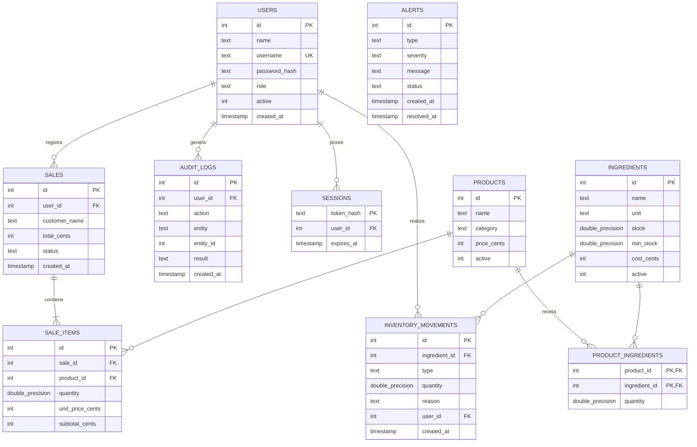

# Modelo de datos

## Decisiones de diseno

- **Dinero en centavos enteros** (`*_cents`) para evitar errores de punto flotante.
- **Cantidades DOUBLE PRECISION redondeadas a 3 decimales** (kg, litro) en la capa de dominio.
- **Recetas** en `product_ingredients`: al vender un producto se descuenta
  automaticamente el insumo correspondiente.
- **Movimientos de inventario** tipados (`ENTRADA`, `SALIDA`, `AJUSTE`,
  `CONSUMO`) como fuente de trazabilidad y de la metrica de consumo promedio.
- **Sesiones** guardan el hash del token, nunca el token en claro.
- **`audit_logs`** implementa la trazabilidad minima (usuario, accion, entidad,
  resultado, fecha).
